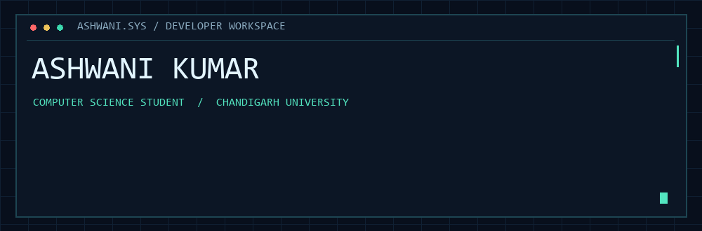

<div align="center">



# Ashwani Kumar

[](https://github.com/teamavishkar)

[](#05--next-mission)
[](https://github.com/teamavishkar?tab=repositories)
[](https://x.com/1313ashwani)

**B.E. Computer Science · Chandigarh University · Second year**

</div>

---

## `01` / Developer identity

I'm Ashwani, a second-year Computer Science student at Chandigarh University and a Sainik School Nalanda alumnus. I work with C++, Java, Python, and React, with interests in data structures, API development, and NLP applications.

My projects range from a campus-life web prototype to resume analysis and developer notification tools. Outside software, I play competitive hockey and have represented my school and zone at national-level events.

## `02` / Project lab

### Agentic Pulse
A developer notification project focused on prioritizing task urgency and suggesting next steps. It includes GitHub repository integration and code-debugging workflows.

**Stack:** React · Python · NLP · GitHub API

### Movie 24
A student-focused movie-rental platform designed around low-cost, 24-hour access passes, with session and ticket updates managed through Firebase Realtime Database.

**Stack:** React · Node.js · Firebase Realtime Database

### [Resume Analyzer ↗](https://github.com/teamavishkar/Resume-Analyzer)
A PDF resume analysis tool that matches skills against a job role using predefined rules, returns a score, and suggests improvements.

**Stack:** Python · Flask · PyPDF2 · NLTK · HTML · CSS · JavaScript

### [Project Nexus ↗](https://github.com/teamavishkar/teamavishkar1)
A team-built campus-life web prototype covering academic tools, student services, and campus information. The mail summarizer uses simulated NLP logic.

**Stack:** HTML · CSS · JavaScript

## `03` / Technology stack

<p>
  
</p>

**Core areas:** Data Structures & Algorithms · Object-Oriented Programming · REST APIs · DBMS · Operating Systems

## `04` / Beyond the terminal

- **Ideathon:** First prize in a university-wide innovation and ideathon competition at Chandigarh University during my first year.
- **Hockey:** Best Defender award and a team gold trophy at the Central Zonal Hockey Championship; participation in national-level events.
- **Writing:** Interested in sharing developer trends, coding insights, and technology news on [X](https://x.com/1313ashwani).

## `05` / Next mission

Software engineering internships where I can contribute to real projects, receive thoughtful code reviews, and strengthen my development skills. I'm especially interested in web applications and developer tools.


## `06` / Build log

[](https://github.com/teamavishkar)

<details>
<summary>Open the developer mission file</summary>

```yaml
name: Ashwani Kumar
education: B.E. Computer Science, Chandigarh University
stage: second-year undergraduate
interests:
  - web applications
  - developer tools
  - NLP applications
next_step: software engineering internship
outside_the_terminal: competitive hockey
```

</details>

---

<div align="center">

### Let's build something worth understanding.

[Explore the code](https://github.com/teamavishkar?tab=repositories) · [Find me on X](https://x.com/1313ashwani)


</div>
